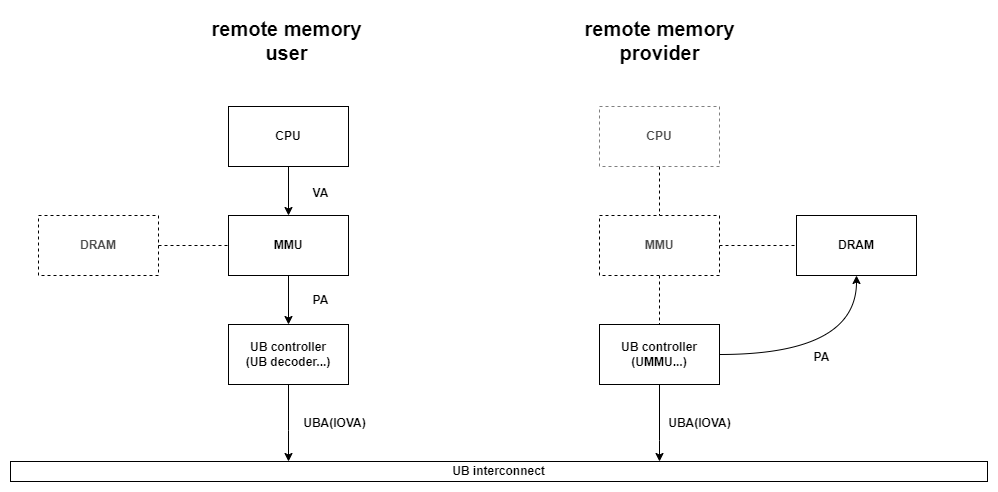

<!-- Copyright (c) 2025-2026 Huawei Technologies Co., Ltd. All rights reserved. -->

# obmm: 基于所有权的内存管理组件

OBMM 是在单机内管理远端内存的基础组件，可以将本地内存导出（export），将其他系统导出的内存引入（import）。export、import 两端的 OBMM 组件依次完成数据通路配置后，import 侧的应用可以像使用本端内存一样，使用 `load` 、`store` 访问远端内存。

OBMM 组件包含用户态库 libobmm.so（详见libobmm(3)） 和内核模块 obmm.ko。本文档介绍 obmm 内核模块功能和参数描述。

OBMM 具备两方面的功能：

* 芯片使能：配置芯片通路，使得 `load`、`store` 指令可以在物理上跨 host 执行
* 软件使能：为远端内存创建易用的软件使用接口，主要包括 remote NUMA 和 OBMM 字符设备（obmm_shmdev(4)）

OBMM 内核模块插入后，会生成一个 misc 设备 /dev/obmm。该设备通过 ioctl(2) 与用户态（主要是libobmm.so）交互，响应用户导出、引入等增删内存设备的请求。

## OBMM 数据通路

OBMM 内核模块可以发起多个 UB memory 访存相关的硬件配置

* MMU 页表
* UB memory decoder 翻译表（当前由管控组件配置）
* UMMU 翻译表

正确配置各组件后，数据通路将被打通，访存流程如下图所示（未显示response）



### decoder配置

UB memory decoder 由高可信硬件配置，使用方 OBMM 以高可信硬件提供的 PA 为起点，配置通路上的其他组件。

## OBMM 内存分配

### 内存来源

UB memory 对提供方的内存有连续性、缓存属性等方面的要求，因此一般要由 OBMM 统一分配。OBMM支持以下内存来源：

- hugetlb_pmd: 使用pmd映射的hugetlb的方式申请内存。此时每个本地NUMA节点配置的hugetlb页面为申请范围（4K页详见`/sys/devices/system/node/node${numa_id}/hugepages/hugepages-2048kB/`，64K页详见`/sys/devices/system/node/node${numa_id}/hugepages/hugepages-524288kB/`）。
- hugetlb_pud: 使用pud映射的hugetlb的方式申请内存。此时每个本地NUMA节点配置的hugetlb页面为申请范围。该分配器的粒度为 `PUD_SIZE`，其可用性和实际大页尺寸取决于页大小与 VA 位宽：PAGE_SIZE=4K 时 PUD_SIZE=1GB（对应 `hugepages-1048576kB/`）；PAGE_SIZE=64K 且 VA 为 42-bit 时 PUD 被折叠为 512MB（对应 `hugepages-524288kB/`，与 PMD 同尺寸）；PAGE_SIZE=64K 且 VA 为 48/52-bit 时 PUD_SIZE=4TB，内核不会注册该尺寸的 hugetlb hstate，分配必然失败。因此 64K 页建议使用 buddy_highmem 或 hugetlb_pmd。该粒度会影响内存export和mempool申请内存。
- buddy_highmem: 使用高端地址的方式申请内存。此时pmd_mapping覆盖的部分为申请范围，但是申请范围不保证能被完全申请，这些内存被本地使用时，会持续尝试申请。

| 类型 | 申请内存来源 | 申请内存粒度 | UMMU页表粒度配置 | 其他限制 |
| --- | --- | --- | --- | --- |
| hugetlb_pmd | hugetlbfs中的pmd粒度大页 | PMD（4K页为2M，64K页为512M） | 4K页必须配置为2M；64K页取芯片支持的合法粒度值，且不大于申请内存粒度PMD（512M），并需保证PMD申请粒度按该粒度对齐 | 仅支持pmd_mapping == 100%时使用（64K页需rodata=full），需要由用户或者kernel cmdline预留pmd大页内存 |
| hugetlb_pud | hugetlbfs中的pud粒度大页 | PUD_SIZE（4K页为1G；64K页+42-bit VA为512M；64K页+48/52-bit VA不可用） | 取芯片支持的合法粒度值，且不大于申请内存粒度PUD_SIZE，并需保证PUD申请粒度按该粒度对齐（推荐32M） | 不受pmd_mapping限制，需要由用户或者kernel cmdline按实际 PUD_SIZE 预留大页；64K页+48/52-bit VA不可用 |
| buddy_highmem | 直接从buddy或者使用pfn申请内存 | 通过驱动加载mem_allocator_granu参数配置，必须是UMMU页表粒度的整数倍 | 取芯片支持的合法粒度值，且须整除mem_allocator_granu（推荐2M 或者32M） |  pmd_mapping配置的比例为各NUMA可借出内存比例的上限 |

UMMU 页表粒度的取值范围取决于芯片代际：first-gen 为 2M~256M（索引 0~7），其他代际为索引 0~14 中的偶数，对应 2M、8M、……、32G。单次最大借出内存由 UMMU 的 ATE 数量决定，并非固定公式，“128K * 2 * 页表粒度”仅为特定硬件配置下的参考值。

内存来源在插入obmm.ko内核模块时通过mempool_allocator模块参数配置，不允许运行时修改，不允许多个内存来源共存。

### 内存池

为加速内存分配，OBMM 维护了一个可选的缓冲内存池。该内存池的目标大小由内核模块参数 `mempool_size` 决定；扩充由池线程周期性（约每 5 秒）检查并执行，`mempool_refill_timeout` 只用于在收缩或分配失败后延迟重新允许扩充，并不是周期性的填充间隔。导出内存时，会优先从缓冲内存池中申请内存，如果缓冲内存池中内存不足，再从上述内存源向系统申请内存。当收到直接回收或 kswapd 回收通知（buddy_highmem 池）或大页回收通知（hugetlb 池）时，OBMM 会将池中空闲（未借出）的内存归还系统，已借出的内存不受影响；回收类型与池类型不匹配时不收缩。

每个 NUMA 节点内存池的总量（含已借出与空闲部分）可通过 `max_total` sysfs 属性设置上限（无对应的内核模块参数），默认无限制。

内存池状态可通过 sysfs 查看，详见 obmm_mempool_sysfs(5)。

## OBMM 部署

### 内核启动项

OBMM内核模块依赖以下内核参数：
1. 若想要使用NUMA上线功能，需要配置numa_remote参数。若想要使用预上线功能，需进一步配置numa_remote=preonline。
    该参数详细说明如下：
```
    numa_remote=    [ARM64,KNL]
        Prepare unused NUMA Nodes as remote Nodes, allows to hotplug
        remote memory on these remote NUMA Nodes when CONFIG_NUMA_REMOTE
        is enabled. By default, all unused NUMA Nodes will be configured
        as remote Nodes. cmdline numa_remote_max_nodes can be used to limit
        the number of remote NUMA Nodes.
        Format: [arg0,][arg1]
        preonline - allow to online unready memory and keep them isolated,
                    to improve the online performance.
        nofallback - the remote nodes don't appear in the zonelists of
                      other nodes, the remote memory can only be allocated by
                      specifying the remote node.
        hugetlb_nowatermark - allocate hugetlb in remote node will ignore
                              watermark, and all memory can be allocated as
                              hugetlb.
        <int> - limit the number of remote NUMA Nodes.
```
    注意：解析器仅识别 `nofallback`；其他拼写（例如把 `no` 写成 `non`）会被静默忽略，既不报错也不会生效。
2. 为了申请内存时正确修改内核页表属性，需要配置pmd_mapping参数。
    mempool_allocator配置成buddy_highmem时，需要配置pmd_mapping参数，该参数配置比例的系统内存为最大可借出内存；配置成hugetlb_pmd时，需要配置pmd_mapping=100%。
    **注意：当PAGE_SIZE为64K时，无需配置pmd_mapping参数**，此时需改用rodata=full参数（见下条第3点）。
    该参数详细说明如下：
```
    pmd_mapping=    [ARM64,KNL]
            Format: nn%
            Allows to allocate contiguous memory from special pfn
            range, the liner mapping granule of this ranfe is never
            larger than PMD. pmd_mapping specifies the percent of
            memory of each node. pmd_mapping=100% is used for hugetlb
            scenarios, the whole linear mapping isn't large than PMD.
```
3. 当PAGE_SIZE为64K时，需配置内核启动参数 `rodata=full` 以使能内存分配器（buddy_highmem、hugetlb_pmd）。此时PMD_SIZE为512M，无需配置pmd_mapping参数。hugetlb_pud 在 64K 页下不建议使用：42-bit VA 时 PUD 折叠为 512M（可用但粒度为 512M），48/52-bit VA 时 PUD=4TB 且内核未注册该 hstate，分配必然失败。若缺少 `rodata=full`，模块仍可加载成功，但 hugetlb_pmd/buddy_highmem 会在运行时分配内存失败。该参数详细说明如下：
```
    rodata=         [KNL,EARLY]
        on      Mark read-only kernel memory as read-only (default).
        off     Leave read-only kernel memory writable for debugging.
        full    Mark read-only kernel memory as read-only.
```

###前置内核模块依赖
OBMM 依赖的内核配置项中，`UB_UMMU_CORE`、`UB_UBUS`、`HISI_SOC_CACHE` 及 `TRANSPARENT_HUGEPAGE` 等必须在内核配置中使能（这些均为内建选项，不能通过 insmod/modprobe 加载）。其中 UMMU core 以 ummu_core_builtin.o 内建，不存在名为 hisi_ummu_core 的可加载模块。真正需要额外插入的模块是 hisi_soc_hha：缺失时刷 cache 返回 -EOPNOTSUPP，导出/导入会失败。
依赖的模块/配置中，以下参数会对OBMM的导入导出产生影响：
- UMMU 模块 ubm_granule参数影响OBMM分配的连续内存最小粒度。该参数配置为0以外的值时，OBMM申请内存的最小粒度须相应提升, 需正确选择内存来源。

### OBMM模块参数

OBMM 内核模块为 `obmm.ko` ，支持下列 5 个内核模块参数（注意：它们是模块参数，不是普通内核启动参数）。可在加载时直接传入，如 `insmod obmm.ko mempool_size=2G mempool_allocator=buddy_highmem`；若写在内核命令行，则必须带 `obmm.` 前缀（如 `obmm.mempool_size=2G`），否则会被忽略。这些参数在模块加载后均只读（/sys/module/obmm/parameters 下权限为 0440/0444），不能在运行时修改。

1. **mempool_size=(\\d+)[KMG]**：用于配置OBMM缓冲内存池的目标大小，默认为1G。该参数设定所有本地 NUMA 节点合计的空闲缓冲（available）目标，会按本地节点数均分；每个节点的 available 目标水位为 mempool_size / 本地节点数。该目标并非单节点可借出内存的硬上限；实际可借出总量还受 sysfs 的 max_total 限制，已借出（used）内存不计入该目标。例如mempool_size=4G，有4个本地NUMA节点时，OBMM会为每个本地NUMA节点至多保留1G空闲缓冲。OBMM会动态、异步地从内存源申请释放内存，将空闲缓冲维持在目标大小附近，用于提升内存的借出速度。
2. **mempool_refill_timeout=(\\d+)**：本地内存不足触发OBMM缓冲池收缩后，延迟重新允许扩充内存池的等待时间，单位为毫秒，默认为30000。OBMM在收到直接回收/kswapd（buddy_highmem 池）或大页回收（hugetlb 池）通知时，会将池中空闲的 uncleared 与 ready 内存归还系统，已借出的内存不会被释放；仅当回收类型与池类型匹配时才会收缩。收缩后需等待 mempool_refill_timeout 毫秒才重新允许扩充。
3. **mempool_allocator**：用于指定OBMM导出内存时的内存来源。当前支持hugetlb_pmd, hugetlb_pud, buddy_highmem三种内存来源。未指定时，默认为buddy_highmem。hugetlb_pmd和hugetlb_pud表示内存来自Linux hugetlbfs，内存需要在sysfs中手动预留后方可使用。仅当pmd_mapping=100%时（64K页为rodata=full），mempool_allocator允许使用hugetlb_pmd。buddy_highmem表示内存来自Linux内核的buddy allocator，内核会尝试动态组合buddy allocator中的页以满足OBMM的粒度要求。
4. **mem_allocator_granu=(\\d+)**：用于指定OBMM导出内存的粒度。每个单位的内存物理地址连续，用于满足UMMU硬件的要求。支持 K/M/G 等后缀（memparse）。所有分配器都要求该值不小于 2M（OBMM_BASIC_GRANU）、为 2M 的整数倍且为 2 的幂（即 2M、4M、8M……）。未指定时，buddy_highmem 默认为 2M，hugetlb_pmd 默认为 PMD_SIZE，hugetlb_pud 默认为 PUD_SIZE。hugetlb_pmd仅支持PMD_SIZE为唯一粒度（4K页场景下为2M，64K页场景下为512M），hugetlb_pud仅支持PUD_SIZE为唯一粒度（4K页为1G；64K页+42-bit VA为512M；64K页+48/52-bit VA没有对应 hstate，不可用）。
5. **skip_cache_maintain**：调试参数（bool，默认 false，权限 0444）。置为 true 时跳过 cache 维护操作，仅用于仿真等无法完成 cache 维护的场景；生产环境禁止使用，否则会造成数据不一致。

加载与卸载示例：

```shell
insmod obmm.ko mempool_size=2G mempool_allocator=buddy_highmem mem_allocator_granu=2M
rmmod obmm
```

参数或环境校验失败时的表现：

- 加载阶段直接失败（`obmm_init` 返回 `-EINVAL`，insmod 报错）：`mempool_allocator` 取值非法（仅支持 `hugetlb_pmd`、`hugetlb_pud`、`buddy_highmem`）；4K 页下 `pmd_mapping` 不为 100% 却选择 `hugetlb_pmd`；`mem_allocator_granu` 非法（小于 2M、不是 2M 的整数倍、不是 2 的幂，或与 `hugetlb_pmd`/`hugetlb_pud` 的固定粒度不符）。
- 加载成功但后续操作才失败：64K 页缺少 `rodata=full` 时，`hugetlb_pmd`/`buddy_highmem` 在 export/import 时分配内存失败；`ubm_granule` 与 `mem_allocator_granu` 不匹配时申请连续内存失败；64K 页 + 48/52-bit VA 选择 `hugetlb_pud` 时模块可加载，但永远申请不到内存（export/import 失败）。
- 仍有内存设备处于打开状态时，`rmmod obmm` 会失败（模块引用计数非 0）。


## OBMM 设备

OBMM 内核模块插入后，会生成 `/dev/obmm` 设备，默认权限为 root:root 0600，即默认仅 root 可访问。如需非 root 访问，需通过 udev 规则调整，例如 `KERNEL=="obmm", MODE="0660", GROUP="<组名>"`，将设备授予指定用户组（也可写 `MODE="0666"`，但会让任意用户访问，不建议）。授权用户可对该设备执行全部 ioctl，存在安全风险，应仅在明确需要的场景按最小权限配置。用户应通过 libobmm(3) 描述的函数接口来调用 OBMM 功能，不建议直接操作该设备。UB feature 未使能时，所有 ioctl 均返回 -EOPNOTSUPP。

除导出、引入等内存设备的增删请求外，`/dev/obmm` 还承载内存设备的在线后端切换请求（OBMM_CMD_SWITCH_BEGIN / OBMM_CMD_SWITCH_END ioctl，在设备访问权限之外还需要 CAP_SYS_ADMIN 权限），用于在不销毁内存设备的前提下整体更换其承载内存，详见 obmm_switch(3)。
